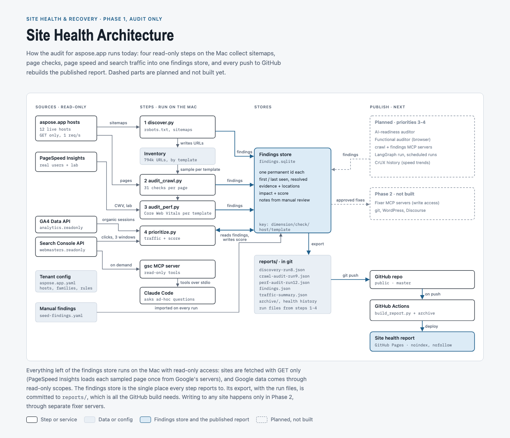

# Site Health & Recovery Agents

Domain-agnostic agents that audit a web property and report what is broken, not optimized, incorrect or improvable. Phase 1 is **audit only**. The project brief and rules are in [`CLAUDE.md`](CLAUDE.md).

## Latest report

**[aspose.app site health report](https://shoaibkhan-aspose.github.io/aspose-app-health-and-recovery/)**: summary, product family health, priorities, shared problems, all findings with a fix guide, and changes since the last run. Previous versions: [archive](https://shoaibkhan-aspose.github.io/aspose-app-health-and-recovery/archive/).

[](https://github.com/shoaibkhan-aspose/aspose-app-health-and-recovery/actions/workflows/pages.yml)

The page is rebuilt and published by GitHub Actions on every push to `master`, from the run files committed in `reports/`. Audits themselves run locally (see Setup).

## Architecture



Full page with the step-by-step table, design rules and code layout: [`docs/architecture/site-health-architecture.html`](docs/architecture/site-health-architecture.html) (also published as a private claude.ai page: https://claude.ai/artifact/3zrEcbrV1WxN9nfjvS7Kxm).

## Layout

```
core/          deterministic logic (no tenant names allowed)
mcp_servers/   MCP servers wrapping core (read-only in Phase 1)
agents/        LLM agents (LangGraph)
tenants/       one YAML per property, e.g. tenants/aspose.app.yaml
scripts/       CLIs, e.g. check_access.py
tests/         offline tests
reports/       run JSON, findings.json and takeaway notes (committed; source of the published report)
```

## Setup (macOS)

```bash
python3 -m venv .venv && source .venv/bin/activate
pip install -e ".[dev,crawl]"
cp .env.example .env          # set the key path (quote it if it has spaces); the key file stays outside the repo
set -a; source .env; set +a
pytest                        # offline tests
python scripts/check_access.py --tenant aspose.app
python scripts/discover.py --hosts products.aspose.app --sections pdf,words   # sample
python scripts/discover.py                                                  # all hosts
python scripts/audit_crawl.py                                              # crawl audit; --sections a,b narrows products only
python scripts/prioritize.py                                               # Search Console traffic + score per finding
python scripts/build_report.py --out reports/discovery-latest.html --snapshot "After <run>"   # report + archive snapshot
```

Findings from every run, plus the manual ones in `tenants/<tenant>.seed-findings.yaml`, are kept in `data/findings.sqlite` with permanent ids, first/last seen and resolved status (`python scripts/findings.py summary`). `scripts/build_report.py` turns the newest discovery and crawl-audit runs plus the store (or `--findings reports/findings.json`) into the HTML report.

## MCP servers

`mcp_servers/gsc`: read-only Search Console tools (`list_properties`, `search_performance`, `page_performance`, `compare_periods`, `list_sitemaps`, `inspect_url`). Needs `pip install -e ".[mcp]"`. Registered for Claude Code in `.mcp.json`; approve it once when Claude Code starts. It reads the key path from `GOOGLE_APPLICATION_CREDENTIALS` or, if unset, from `.env`. Run by hand: `python -m mcp_servers.gsc` (stdio).

`discover.py` is read-only and polite (robots.txt respected, 1 request per host per second, QA hosts skipped). It walks robots.txt and sitemaps for every tenant host, stores the URL inventory in `data/inventory.sqlite` and writes a summary plus sitemap findings to `reports/discovery-<date>-run<N>.json`.

`check_access.py` is read-only. It reports which GSC properties the service account can read (with 28-day clicks, top pages and sitemap errors) and which hostnames GA4 tracks, then writes `reports/access-check-<date>.json`.
